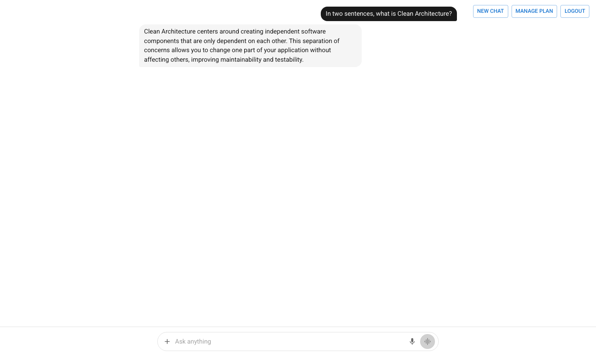
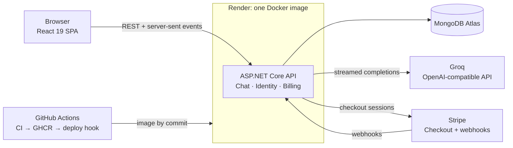
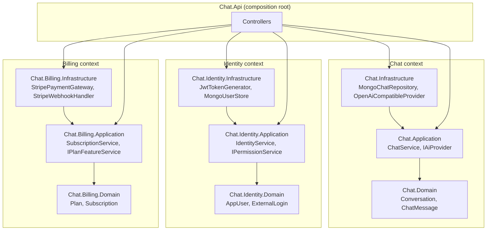

# ChatApp

**A production-shaped AI chat platform:** streamed LLM replies, plan-based billing through
Stripe, 800+ automated tests, and a live deployment shipped through CI/CD.

[](https://github.com/asifarshadullah/chatapp/actions/workflows/ci.yml)


**[Try the live demo →](https://chatapp-2uzj.onrender.com)** Register with any email and chat
with `gpt-oss-120b` on Groq. It runs on Render's free tier, so the first visit after a quiet
spell can take about a minute to wake up.



---

## What this project demonstrates

- **Domain-driven structure.** Chat, Identity and Billing are separate bounded contexts, each in
  Clean Architecture layers. They share only a user id, and project references enforce the
  boundaries at compile time.
  ([trade-off notes](docs/architecture/trade-offs/single-vs-multiple-bounded-contexts.md))
- **Streaming LLM replies.** Tokens stream as server-sent events over one HTTP request, from
  any OpenAI-compatible model: Ollama locally, Groq when deployed.
  ([ADR 0002](docs/architecture/decisions/0002-stream-chat-replies-over-sse.md))
- **Payments that stay consistent.** Stripe Checkout in test mode, with webhooks that are safe
  to receive late, twice or out of order.
  ([ADR 0003](docs/architecture/decisions/0003-sync-billing-from-stripe.md))
- **Secure sessions.** Short-lived JWT access tokens, rotating refresh tokens in an `HttpOnly`
  cookie with replay detection, and renewal that is safe across tabs.
  ([ADR 0001](docs/architecture/decisions/0001-revocation-follows-user-intent.md))
- **Authorization.** Permission policies with cached role lookups, and every conversation
  scoped to its owner.
- **Test discipline.** Every change starts as a failing test: xUnit unit and integration tests
  against a real MongoDB, Vitest component tests, and Playwright end-to-end tests against a
  real model.
- **Delivery.** One Docker image serves the UI and the API. CI runs on every pull request, and
  a deploy publishes to GitHub Container Registry and releases to Render only after the checks
  pass.

---

## Engineering highlights

**One tab could sign out every tab.** Refresh tokens rotate in families, and reusing a spent
one revokes the whole family, which is what catches a stolen token. But two tabs renewing at
once looked like that reuse ([#1](https://github.com/asifarshadullah/chatapp/issues/1)), and a
tab whose own renewal was refused, or whose session simply expired, ended the session for every
other tab ([#5](https://github.com/asifarshadullah/chatapp/issues/5),
[#8](https://github.com/asifarshadullah/chatapp/issues/8)). The fixes allow a short grace window
for concurrent renewal, keep one tab's failure to itself, and revoke only when the user signs
out ([ADR 0001](docs/architecture/decisions/0001-revocation-follows-user-intent.md)).

**Stripe's events arrive late, twice, or out of order.** Instead of applying each event's
payload, every event makes the app re-read the subscription from Stripe and store what it says
now. A unique index and a single upsert keep one record per user, and a late cancellation of an
old subscription cannot take Pro away from a new one
([ADR 0003](docs/architecture/decisions/0003-sync-billing-from-stripe.md),
[#42](https://github.com/asifarshadullah/chatapp/pull/42)).

**A daily limit that holds under concurrency.** Each user has one counter per UTC day,
incremented in a single atomic MongoDB operation, so messages sent at the same moment cannot
both take the last place. The limit comes from the user's plan through a port, so Chat never
references Billing
([MongoDailyMessageQuota](backend/src/Chat.Infrastructure/Quota/MongoDailyMessageQuota.cs)).

**SignalR was replaced by server-sent events.** The app never needed a persistent two-way
connection. Each reply is now one HTTP request: it authenticates like every other call, refusals
are ordinary status codes, closing the request stops the model, and a reply cut short is saved
with what was produced ([ADR 0002](docs/architecture/decisions/0002-stream-chat-replies-over-sse.md),
[#25](https://github.com/asifarshadullah/chatapp/pull/25)).

---

## Architecture



Inside the API, the code is split into three **bounded contexts**, each in **Clean
Architecture** layers (Domain → Application → Infrastructure). Only the API project references
all three, to wire them together.



[docs/architecture/](docs/architecture/) follows a reply from request to stream, explains the
decisions behind this design, and includes a retrospective on where the up-front design turned
out to be wrong.

---

## Try it

On the [live demo](https://chatapp-2uzj.onrender.com):

1. Register with any email and send a message. The reply streams in word by word, and the
   conversation appears in the sidebar with a title the model chose.
2. Free allows 10 messages a day. To upgrade, open **Manage Plan** and choose **Subscribe** on
   Pro.
3. Pay on Stripe's test checkout with card `4242 4242 4242 4242`, any future expiry date and any
   CVC. Nothing is charged. Back in the app, Manage Plan shows Pro within a few seconds, and you
   can send 100 messages a day.
4. **Cancel subscription** keeps Pro until the end of the month you paid for, and shows the date
   it ends.

### Known limitations

- The live demo offers only Groq's free tier, about 100 messages a day shared by all users,
  whatever their plans allow.
- Upgrades run in Stripe's test mode, so no real payment is possible, and anyone can reach Pro
  with the test card. Google sign-in is set up only for local runs.
- A reload while a reply is streaming keeps what was produced but stops the rest
  ([#27](https://github.com/asifarshadullah/chatapp/issues/27)).

---

## How it's built

Every change starts as a GitHub issue. Anything beyond a small fix is planned with
[OpenSpec](https://github.com/Fission-AI/OpenSpec) before code is written: a proposal, a design
and spec scenarios, reviewed first and then archived with the change, so
[`openspec/specs/`](openspec/specs/) describes what the app does today. Each task starts as a
failing test. A merged issue moves to a `qa` label and is closed only once the behaviour has
been checked by hand. [#42](https://github.com/asifarshadullah/chatapp/pull/42) is a typical
pull request: the issue, the spec, the tests and the manual checks in one place.

The code is written with AI assistance, using Claude Code. Its working rules are in
[`CLAUDE.md`](CLAUDE.md): I review every proposal and diff, approve every commit, and every
change passes the full test suites before it merges. The `.claude/` and `.agents/` folders hold
that tooling's commands and skills.

---

## Tech stack

| Category | Technology |
|----------|-----------|
| Backend | .NET 8, ASP.NET Core |
| Frontend | React 19, TypeScript 5, Vite, MUI |
| Database | MongoDB 7 (Atlas when deployed, Docker Compose locally) |
| Streaming | Server-sent events from an `IAsyncEnumerable` reply, read with `fetch` |
| AI / LLM | OpenAI .NET SDK against any chat completions API: Ollama locally, Groq (`openai/gpt-oss-120b`) when deployed |
| Payments | Stripe Checkout and webhooks (Stripe.net 45) |
| Auth | JWT access tokens, rotating refresh tokens, Google OAuth 2.0 |
| Authorization | ASP.NET Core policies and a custom `IPermissionService` with a memory cache |
| Testing | xUnit, FluentAssertions, Vitest, React Testing Library, Playwright |
| Delivery | Docker, GitHub Actions, GitHub Container Registry, Render |

---

## Quick start

You need Docker, the .NET 8 SDK, Node.js 20+ and [Ollama](https://ollama.com/).

```bash
docker compose up -d                                  # MongoDB
ollama pull gemma3:4b                                 # the local model
dotnet run --project backend/src/Chat.Api             # API on :5064
cd frontend/chat-ui && npm install && npm run dev     # app on :5173, in a second terminal
```

Open http://localhost:5173, register and chat. [docs/development.md](docs/development.md)
covers the tests, a hosted model, Google sign-in, Stripe and the production image, and
[docs/deployment.md](docs/deployment.md) covers the live deployment.

---

## Roadmap

- [#27](https://github.com/asifarshadullah/chatapp/issues/27) Generate replies in the background, so they survive a reload
- [#18](https://github.com/asifarshadullah/chatapp/issues/18) Retrieval over uploaded documents, with citations, and tool calling
- [#19](https://github.com/asifarshadullah/chatapp/issues/19) Observability with OpenTelemetry, Prometheus and Grafana
- [#20](https://github.com/asifarshadullah/chatapp/issues/20) Several instances behind a load balancer, measured with load tests
- [#22](https://github.com/asifarshadullah/chatapp/issues/22) A rate limiter as a separate Go service

---

## Author

Built by **Asif Muhammad Arshadullah**

- GitHub: [@asifarshadullah](https://github.com/asifarshadullah)
- LinkedIn: [asif-arshadullah](https://www.linkedin.com/in/asif-arshadullah)

## License

MIT, see [LICENSE](LICENSE).
