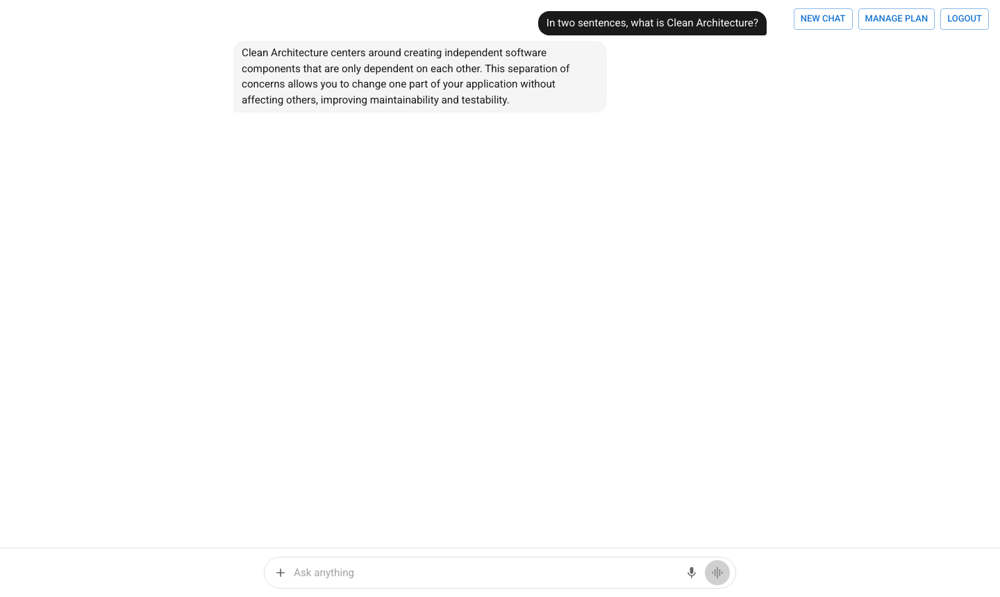
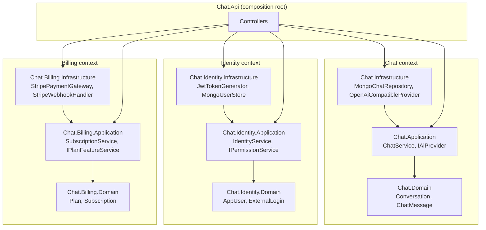
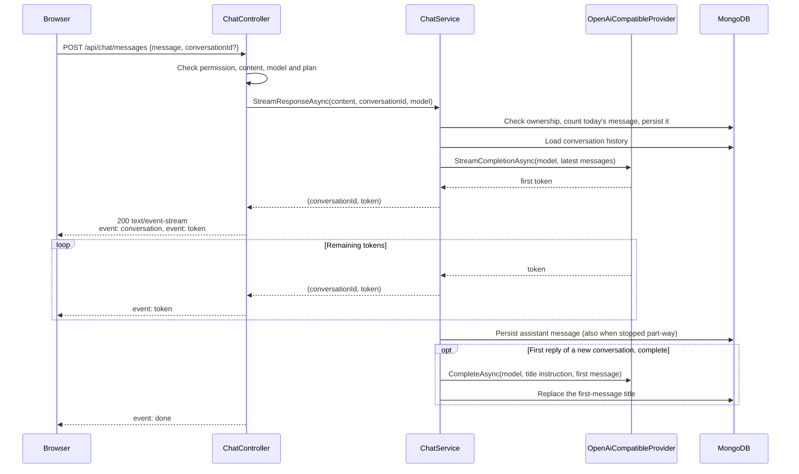
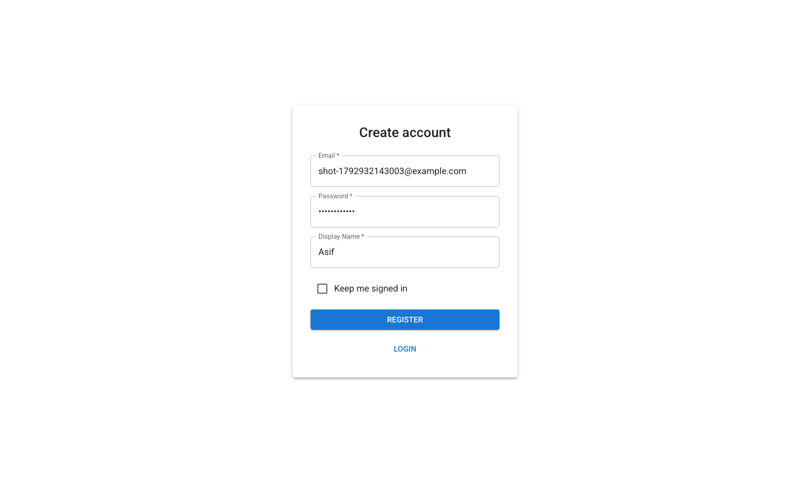

# ChatApp — Real-time AI Chat Application

A ChatGPT-style chat application built end-to-end with Clean Architecture, TDD, and a modern real-time stack. Features word-by-word streaming responses from any OpenAI-compatible model (a local Ollama model in development, Groq when deployed), JWT/OAuth authentication, role-based authorization with permission policies, and Stripe billing — all separated into independent bounded contexts.


[](https://github.com/asifarshadullah/chatapp/actions/workflows/ci.yml)


**[Live demo](https://chatapp-2uzj.onrender.com)** — register with any email and chat with `gpt-oss-120b` on Groq. It runs on Render's free tier, so the first visit after a quiet spell can take about a minute to wake up.



---

## Features

- **Real-time streaming** — word-by-word LLM responses as server-sent events over one HTTP request
- **Conversation links** — the open conversation lives in the URL (`?conversation=<id>`), so a reload, a new tab or a bookmark reopens it with its history
- **Saved conversations** — a sidebar lists your conversations, most recently active first, from `GET /api/chat/conversations` a page at a time; each is titled by the model after its first reply
- **Any OpenAI-compatible model** — one provider for the chat completions API: Ollama locally, Groq when deployed, and others by configuration alone
- **Settings** — a gear button opens a Settings dialog whose Model dropdown lists the models this deployment offers; the choice is remembered in the browser
- **Fair use** — each user may send 50 messages per UTC day, so no one can use up a shared model allowance
- **Authentication** — JWT access tokens and Google OAuth 2.0
- **Authorization** — role-based permission policies (`CanChat`, `AdminOnly`, etc.) with 5-minute cached role lookups
- **Billing** — Stripe Checkout, webhook-driven subscription lifecycle, plan-based feature gating
- **Persistence** — MongoDB 7 via Docker Compose with typed document mappings
- **Testing** — automated tests across 3 levels (unit, integration, E2E) following strict TDD
- **Deployment** — one Docker image serves the UI and the API from one origin; deploys are started by hand from GitHub Actions, only after the tests pass

---

## Architecture

The codebase is split into three independent **bounded contexts** (Chat, Identity, Billing), each following **Clean Architecture** layering (Domain → Application → Infrastructure → API). Only the API project references all three contexts for dependency injection wiring.

### Bounded contexts × layers



### Streaming chat request flow



---

## Tech Stack

| Category | Technology |
|----------|-----------|
| Backend | .NET 8, ASP.NET Core (Controllers) |
| Frontend | React 19, TypeScript 5, Vite, MUI |
| Database | MongoDB 7 (Docker Compose) |
| Real-time | Server-sent events from an `IAsyncEnumerable` reply, read with `fetch` |
| AI / LLM | OpenAI .NET SDK against any chat completions API: Ollama locally, Groq (`openai/gpt-oss-120b`) when deployed |
| Payments | Stripe (Stripe.net 45) — Checkout + webhooks |
| Auth | JWT bearer tokens + Google OAuth 2.0 |
| Authorization | ASP.NET Core policies + custom `IPermissionService` with memory cache |
| Testing | xUnit, FluentAssertions, Vitest, React Testing Library, Playwright |
| Infrastructure | Docker (one image for UI and API), Docker Compose for local MongoDB |
| Deployment | GitHub Actions → GitHub Container Registry → Render, with MongoDB Atlas |

---

## Project Structure

```
backend/
├── src/
│   ├── Chat.Api/                     # Composition root — controllers, DI
│   ├── Chat.Domain/                  # Conversation, ChatMessage entities
│   ├── Chat.Application/             # ChatService, IAiProvider, DTOs
│   ├── Chat.Infrastructure/          # MongoChatRepository, OpenAiCompatibleProvider, daily message counts
│   ├── Chat.Identity.Domain/         # AppUser, ExternalLogin
│   ├── Chat.Identity.Application/    # IdentityService, IPermissionService
│   ├── Chat.Identity.Infrastructure/ # JwtTokenGenerator, MongoUserStore
│   ├── Chat.Billing.Domain/          # Plan, Subscription, Feature enum
│   ├── Chat.Billing.Application/     # SubscriptionService, IPlanFeatureService
│   └── Chat.Billing.Infrastructure/  # StripePaymentGateway, StripeWebhookHandler
└── tests/                            # xUnit test projects per layer
frontend/chat-ui/                     # React 19 + Vite + TypeScript + MUI
e2e/playwright/                       # Playwright E2E tests
docs/architecture/                    # Trade-off write-ups and design retrospectives
openspec/                             # Specs and change proposals
docker-compose.yml                    # MongoDB 7 + Mongo Express, and the app under the `app` profile
Dockerfile                            # Production image: built UI + API on one origin
```

---

## Getting Started

### Prerequisites

- [Docker](https://www.docker.com/) (for MongoDB)
- [.NET 8 SDK](https://dotnet.microsoft.com/download)
- [Node.js 20+](https://nodejs.org/)
- [Ollama](https://ollama.com/) with a pulled model (default: `gemma3:4b` ≈ 3 GB — use `gemma3:2b` ≈ 1.5 GB for lighter setup)

### Happy path (chat works, no OAuth or billing setup needed)

```bash
# 1. Start MongoDB
docker compose up -d

# 2. Pull the LLM model
ollama pull gemma3:4b

# 3. Start the backend (terminal 1)
cd backend
dotnet run --project src/Chat.Api

# 4. Start the frontend (terminal 2)
cd frontend/chat-ui
npm install
npm run dev
```

Open http://localhost:5173. Register with email + password, then chat. The local model is the default; the gear button opens Settings, where the Model dropdown shows what is offered.

To try Groq locally too, keep its key in the macOS Keychain and start the backend through `scripts/with-groq.sh`, which hands the key to that one command only. Groq then appears in the dropdown, while the local model stays the default:

```bash
# once: store the key (you are prompted for it; nothing is echoed or saved in your shell history)
security add-generic-password -a "$USER" -s chatapp-groq-key -w

# each time: run the backend, or the production image, with the key
scripts/with-groq.sh dotnet run --project backend/src/Chat.Api
scripts/with-groq.sh docker compose --profile app up --build
```

The first time, macOS may ask whether `security` may read the item; choose Always Allow. `dotnet user-secrets set "Ai:Models:groq:ApiKey" …` works too, but keeps the key in a plain JSON file in your home folder.

### Run the production image locally

The image that is deployed also runs on your machine, against the local MongoDB and your Ollama:

```bash
ollama pull gemma3:4b
docker compose --profile app up --build
```

Open http://localhost:8080. It offers the local model, and Groq too when compose runs through `scripts/with-groq.sh`. Use Chrome or Firefox: the app runs in Production mode, so its refresh cookie is `Secure`, and Safari may not keep a `Secure` cookie on plain `http://localhost`. On Linux, start Ollama with `OLLAMA_HOST=0.0.0.0` so the container can reach it.



### Deploying

Deploys are started by hand from **Actions → Deploy** on a branch you pick, and only run after the CI checks pass on it. See [docs/deployment.md](docs/deployment.md) for how it works and the one-time Render and MongoDB Atlas setup.

<details>
<summary><b>Optional: enable Google OAuth login</b></summary>

1. Create OAuth credentials at [Google Cloud Console](https://console.cloud.google.com/apis/credentials)
2. Authorized redirect URI: `http://localhost:5064/auth/callback/google`
3. Set values in `backend/src/Chat.Api/appsettings.Development.json`:
   ```json
   "Google": {
     "ClientId": "your-client-id.apps.googleusercontent.com",
     "ClientSecret": "your-client-secret"
   }
   ```
4. Restart the backend. A "Sign in with Google" button appears on the login page.

</details>

<details>
<summary><b>Optional: enable Stripe billing</b></summary>

1. Get test-mode keys from [Stripe Dashboard](https://dashboard.stripe.com/test/apikeys)
2. Create two test-mode products (Pro and Enterprise) and copy their price IDs
3. Set values in `backend/src/Chat.Api/appsettings.json`:
   ```json
   "Stripe": {
     "SecretKey": "sk_test_...",
     "WebhookSecret": "whsec_...",
     "PriceIds": {
       "Pro": "price_...",
       "Enterprise": "price_..."
     }
   }
   ```
4. Run the Stripe CLI to forward webhooks during local dev:
   ```bash
   stripe listen --forward-to localhost:5064/webhooks/stripe
   ```
5. The "Manage Plan" button in the chat header opens the billing page.

</details>

---

## Running Tests

```bash
# Backend (xUnit + FluentAssertions)
dotnet test backend/ChatApp.sln

# Frontend (Vitest + React Testing Library)
cd frontend/chat-ui
npm run test:run

# E2E (Playwright — Chromium)
cd e2e/playwright
npx playwright test
```

> The MongoDB integration tests require Docker Compose to be running. All other tests run without external dependencies (API tests use an in-memory `IChatRepository`, a fake `IAiProvider`, and a test auth handler — see `ChatApiFactory` and `AuthApiFactory`).

---

## Architecture Decisions

Four non-obvious decisions worth calling out. Each reflects a real trade-off rather than a copied template.

### 1. `IAiProvider` abstraction in Application, `OpenAiCompatibleProvider` in Infrastructure

The Application layer defines *what it needs* (`IAiProvider.StreamCompletionAsync(model, history)`), and Infrastructure supplies the implementation: one provider for the OpenAI chat completions API, which Ollama, Groq, OpenRouter, Gemini and others all serve. Model options are configuration: each is a base URL, model and key, and an option is offered only when its key is set. So the image ships Groq without a key, Render supplies it, and the local model, defined only in development settings, can never appear on the live app. Each request carries only the latest 10 messages and caps the reply at 800 tokens, which keeps it inside a free tier's per-minute token limit. Tests inject a `FakeAiProvider`, and the provider itself is tested against a fake HTTP handler that replays a recorded event stream.

### 2. Three bounded contexts: Chat / Identity / Billing

Instead of one monolithic `Chat.Domain`, each concern is its own independent context with its own Domain, Application, and Infrastructure projects. They share only `Guid UserId` across boundaries — no entity leakage, no cross-context imports. The payoff: adding Stripe billing didn't force changes to messaging or auth; adding Google OAuth didn't force changes to billing. Context boundaries are enforced by project references at compile time, not by discipline at review time.

### 3. Server-sent events over one request per reply

Each message is a `POST /api/chat/messages` whose response streams the reply as server-sent events: the conversation id, then each token, then an end marker. The traffic is a request with a streamed response, so it travels as one: the token rides in the `Authorization` header like every other call, refusals are ordinary 400/403/404/429 responses sent before the stream starts (and 502 or 503 when the model fails before its first token), closing the request stops the model, and any instance can serve any reply. A reply that stops part-way, because the caller left or the model failed, is saved with what was produced, so reloading mid-reply keeps it. `ChatService.StreamResponseAsync` stays an `IAsyncEnumerable<(Guid, string)>`, and the controller only frames and flushes it. This replaced a SignalR hub whose persistent connection the app never needed; [ADR 0002](docs/architecture/decisions/0002-stream-chat-replies-over-sse.md) records why.

### 4. Feature gating via `IPlanFeatureService` in `Chat.Billing.Application`

Cross-cutting concerns often end up in the wrong layer. Feature flags aren't an Identity concern (they're not about *who* you are) and aren't a Chat concern (they're not about *how* messaging works) — they're a billing concern (what your plan *entitles* you to). The chat endpoint calls `IPlanFeatureService.IsEnabledAsync("chat", userId)` before streaming; `RealPlanFeatureService` lives in Billing.Infrastructure and makes the subscription/plan decision. Placing the interface in the billing context, not in `Chat.Application`, is what keeps the dependency graph one-way.

Longer write-ups live in [docs/architecture/](docs/architecture/) — the trade-offs behind the context split and the MongoDB document design, and a scenario followed from requirement through design to a retrospective on where the up-front design turned out to be wrong.

---

## How it's built

Every change starts as a GitHub issue. Anything beyond a small fix is planned with [OpenSpec](https://github.com/Fission-AI/OpenSpec) before code is written: a proposal, a design and spec scenarios, reviewed first and then archived with the change, so [`openspec/specs/`](openspec/specs/) describes what the app does today. Each task starts as a failing test. A merged issue moves to a `qa` label and is closed only once the behaviour has been checked by hand.

The code is written with AI assistance, using Claude Code. Its working rules are in [`CLAUDE.md`](CLAUDE.md): I review every proposal and diff, approve every commit, and every change passes the full test suites before it merges.

---

## Known limitations

- The live demo offers only Groq's free tier, about 100 messages a day shared by all users. Each user may send 50 messages a day.
- Plan upgrades do not work on the live demo yet ([#30](https://github.com/asifarshadullah/chatapp/issues/30)), and Google sign-in is set up only for local runs.
- A reload while a reply is streaming keeps what was produced but stops the rest ([#27](https://github.com/asifarshadullah/chatapp/issues/27)).

## Roadmap

- [#27](https://github.com/asifarshadullah/chatapp/issues/27) Generate replies in the background, so they survive a reload
- [#18](https://github.com/asifarshadullah/chatapp/issues/18) Retrieval over uploaded documents, with citations, and tool calling
- [#19](https://github.com/asifarshadullah/chatapp/issues/19) Observability with OpenTelemetry, Prometheus and Grafana
- [#20](https://github.com/asifarshadullah/chatapp/issues/20) Several instances behind a load balancer, measured with load tests
- [#22](https://github.com/asifarshadullah/chatapp/issues/22) A rate limiter as a separate Go service

---

## Author

Built by **Asif Md Arshadullah**

- GitHub: [@asifarshadullah](https://github.com/asifarshadullah)
- LinkedIn: [asif-arshadullah](https://www.linkedin.com/in/asif-arshadullah)

---

## License

MIT — see [LICENSE](LICENSE).
