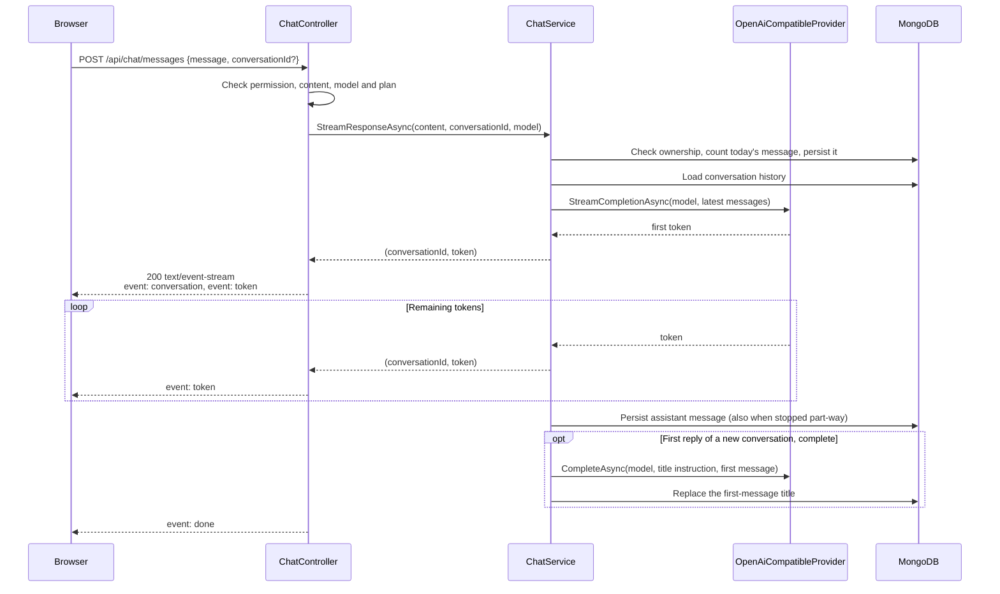

# Architecture Notes

The reasoning behind ChatApp's structural decisions. The [main README](../../README.md)
describes what the architecture *is*; this folder records how it was arrived at, what was
traded away, and where the up-front design turned out to be wrong.

---

## Contents

```
decisions/
  0001-revocation-follows-user-intent.md   Revoke a credential family on user intent, not on circumstance
  0002-stream-chat-replies-over-sse.md     Why replies stream as server-sent events, not SignalR
  0003-sync-billing-from-stripe.md         Why each Stripe event re-reads the subscription

trade-offs/
  single-vs-multiple-bounded-contexts.md   When to split a domain into separate contexts,
                                           and what the split actually cost here
  embedded-vs-separate-collection.md       MongoDB document design: embedding messages in a
                                           conversation versus a separate collection

scenarios/
  01-archive-conversation/                 One feature, followed end to end
    requirement.md                         The feature in plain English
    design.md                              The layer split decided BEFORE any code
    retrospective.md                       What the implementation taught, and where the
                                           design was wrong
```

---

## How a reply travels



---

## Decisions in brief

The short version of four decisions the README highlights. The ADRs and trade-off notes above go deeper.

### 1. `IAiProvider` abstraction in Application, `OpenAiCompatibleProvider` in Infrastructure

The Application layer defines *what it needs* (`IAiProvider.StreamCompletionAsync(model, history)`), and Infrastructure supplies the implementation: one provider for the OpenAI chat completions API, which Ollama, Groq, OpenRouter, Gemini and others all serve. Model options are configuration: each is a base URL, model and key, and an option is offered only when its key is set. So the image ships Groq without a key, Render supplies it, and the local model, defined only in development settings, can never appear on the live app. Each request carries only the latest 10 messages and caps the reply at 800 tokens, which keeps it inside a free tier's per-minute token limit. Tests inject a `FakeAiProvider`, and the provider itself is tested against a fake HTTP handler that replays a recorded event stream.

### 2. Three bounded contexts: Chat / Identity / Billing

Instead of one monolithic `Chat.Domain`, each concern is its own independent context with its own Domain, Application, and Infrastructure projects. They share only `Guid UserId` across boundaries — no entity leakage, no cross-context imports. The payoff: adding Stripe billing didn't force changes to messaging or auth; adding Google OAuth didn't force changes to billing. Context boundaries are enforced by project references at compile time, not by discipline at review time.

### 3. Server-sent events over one request per reply

Each message is a `POST /api/chat/messages` whose response streams the reply as server-sent events: the conversation id, then each token, then an end marker. The traffic is a request with a streamed response, so it travels as one: the token rides in the `Authorization` header like every other call, refusals are ordinary 400/403/404/429 responses sent before the stream starts (and 502 or 503 when the model fails before its first token), closing the request stops the model, and any instance can serve any reply. A reply that stops part-way, because the caller left or the model failed, is saved with what was produced, so reloading mid-reply keeps it. `ChatService.StreamResponseAsync` stays an `IAsyncEnumerable<(Guid, string)>`, and the controller only frames and flushes it. This replaced a SignalR hub whose persistent connection the app never needed; [ADR 0002](decisions/0002-stream-chat-replies-over-sse.md) records why.

### 4. Feature gating via `IPlanFeatureService` in `Chat.Billing.Application`

Cross-cutting concerns often end up in the wrong layer. Feature flags aren't an Identity concern (they're not about *who* you are) and aren't a Chat concern (they're not about *how* messaging works) — they're a billing concern (what your plan *entitles* you to). The chat endpoint calls `IPlanFeatureService.IsEnabledAsync("chat", userId)` before streaming; `RealPlanFeatureService` lives in Billing.Infrastructure and makes the subscription/plan decision. Placing the interface in the billing context, not in `Chat.Application`, is what keeps the dependency graph one-way. The daily message limit follows the same rule: Chat asks its own `IDailyMessageAllowance` port, and a small adapter in the API project answers it from the user's plan, so Chat never references Billing.

---

## The core mental model

Every layer answers one question. Domain: *what is this system about?* Application: *what can
this system do?* Infrastructure: *how does it talk to the outside world?* API: *how does the
outside world reach it?* If a piece of code does not clearly answer the question for its
layer, it is in the wrong place.

Dependencies point inward. The Domain depends on nothing. The Application layer defines the
interfaces it needs — `IAiProvider`, `IPermissionService`, `IPlanFeatureService` — and
Infrastructure supplies the implementations. That is what makes the LLM provider swappable
and the contexts independently testable.

---

## Why the retrospectives exist

A design written before coding is a prediction. The gap between it and what the code turned
out to require is the part worth writing down, and it is the part usually lost.

`scenarios/01-archive-conversation/retrospective.md` is the worked example: a domain
invariant written to guard mutation also blocked the reconstruction path when loading an
archived conversation from MongoDB — something the design had not anticipated. The fix was a
reconstruction constructor that trusts stored data, and the lesson generalises to every
entity that gains a guard.

New scenarios are no longer added here by hand. Non-trivial changes now go through
[OpenSpec](../../openspec/) as reviewed proposals, which serve the same purpose with less
ceremony. This folder keeps the decisions that predate that workflow.

---

## Further reading

- *Domain-Driven Design* — Eric Evans
- *Implementing Domain-Driven Design* — Vaughn Vernon
- *Clean Architecture* — Robert C. Martin
