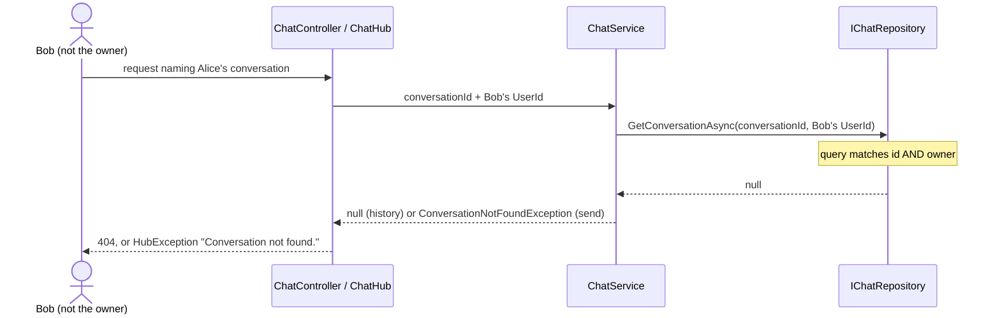

## Context

See proposal.md for why. The Chat context was built before sign-in existed:

- `Conversation` (Chat.Domain) carries an id, a creation time and messages, and no owner.
- `IChatRepository` and `IChatService` (Chat.Application) take a conversation id and never a
  user id.
- `ChatController` and `ChatHub` (Chat.Api) are the only places that know the caller.
  `ChatHub` injects `ICurrentUser` but uses `UserId` only for the plan check;
  `ChatController` does not inject it at all.
- `ICurrentUser` reads the caller from `IHttpContextAccessor`, the HTTP request currently
  running. Measured inside `ChatHub.SendMessage`: over WebSockets it returns the caller, but
  over long polling it reports no signed-in user and `Guid.Empty`, because the hub runs after
  the request that delivered the message has ended. SignalR's `Context.User` returned the
  caller on both transports.
- An unknown id on a send surfaces as an unhandled `KeyNotFoundException`. That is a 500 on
  `POST /api/chat` and SignalR's generic error on the hub.

Contexts share nothing but `Guid UserId`, and dependencies point inward, so Chat.Application
cannot reference Identity's `ICurrentUser`.

## Goals / Non-Goals

**Goals:**

- Make "not yours" and "does not exist" the same outcome at the lowest layer, so no caller
  can tell them apart and no future endpoint can forget the check.
- Keep the Chat context free of any Identity type.

**Non-Goals:**

- A general exception-to-status mapping for the whole API. Only the chat paths are touched.
- An index on the owner. Every lookup is still by `_id`; an owner index belongs to the
  future listing change.

## Decisions

### 1. The owner lives on the `Conversation` entity

`Conversation` gains `Guid OwnerId`. The creating constructor becomes
`Conversation(Guid ownerId)` and the reconstituting one `Conversation(Guid id, Guid ownerId,
DateTime createdAt)`. Both reject `Guid.Empty`, so an ownerless conversation cannot exist in
memory. The old constructor that rebuilt a conversation from an id and a timestamp alone
becomes private, so nothing outside the entity can create one without an owner. The type
stays in Chat.Domain because ownership is a fact about the conversation, not about how it
is stored.

*Alternative:* a separate ownership record keyed by conversation id. Rejected: it adds a
second lookup to every request and can drift from the conversation it describes.

### 2. The owner check is part of the repository query

Every `IChatRepository` method that touches an existing conversation takes `userId`, and
both implementations match on id and owner together:

- `CreateConversationAsync(Guid userId)` stamps the owner.
- `GetConversationAsync(Guid conversationId, Guid userId)` returns `null` when either the id
  or the owner does not match.
- `AddMessageAsync(Guid conversationId, Guid userId, ChatMessage message)` updates only a
  document matching both, and throws `ConversationNotFoundException` when nothing matched.

The interface stays in Chat.Application and is implemented in Chat.Infrastructure
(`MongoChatRepository`, `InMemoryChatRepository`).

*Alternative:* load by id, then compare `OwnerId` in `ChatService`. Rejected: every new
caller would have to remember the comparison, and the repository would keep handing out
other users' conversations to anything that asks.

### 3. Chat.Api passes the user id down as a plain `Guid`

`IChatService` methods gain a `Guid userId` parameter, and each entry point supplies the
caller from the source that is reliable where it runs:

- `ChatController` injects `ICurrentUser` and passes `currentUser.UserId`. Controllers run
  inside the HTTP request, so the request carries the caller.
- `ChatHub` reads the `sub` claim from `Context.User`, which SignalR keeps on the
  authenticated connection, and drops its `ICurrentUser` dependency. It passes that one id
  to both the plan check and `ChatService`, so the two can never disagree about who is
  calling.

`ChatService` and the repository reject `Guid.Empty`, so a caller with no `sub` claim fails
loudly instead of matching nothing.

*Alternatives:* have `ChatService` resolve the caller through an `ICurrentUser`-like
abstraction, rejected because Chat.Application would then depend on Identity and the only
thing contexts may share is the `Guid`. Keep `ICurrentUser` in the hub and run the hub tests
over WebSockets, rejected because correctness would then depend on which transport the
browser negotiates. Read `Context.User` only for ownership and leave the plan check on
`ICurrentUser`, rejected because one method would then have two answers to who is calling.

### 4. A dedicated `ConversationNotFoundException` signals "not found" on sends

The send paths cannot return `null` the way history does, because they return a reply or a
token stream. A new `ConversationNotFoundException`, defined in Chat.Application under
`Chat.Application/Exceptions`, replaces `KeyNotFoundException` in `ChatService` and in both
repositories' `AddMessageAsync`. `ChatController.SendMessage` catches it and returns 404;
`ChatHub.SendMessage` catches it and throws `HubException("Conversation not found.")`,
whose message SignalR forwards to the client. `GetHistoryAsync` keeps returning `null`,
which the controller already maps to 404.

Message validation stays ahead of the conversation lookup on every path: the controller
and hub reject an empty message before calling the service, and `ChatService` builds the
`ChatMessage`, which enforces the length limit, before it looks the conversation up. That
ordering is what keeps an invalid message from revealing anything about the conversation
it names.

C# does not allow `yield return` inside a `try` that has a `catch`, so the hub drives the
service's async enumerator by hand and wraps each `MoveNextAsync` in the `try`. The
conversation lookup happens before the first token, so the failure arrives before any
`ReceiveConversationId` message is sent.

*Alternatives:* catch `KeyNotFoundException`, which would turn unrelated bugs into silent
404s; or add global exception middleware, which is a wider change than this one needs.

### 5. Ownerless documents are excluded by the query, not migrated

`ConversationDocument` gains `OwnerId`, stored as a string like `Id`. A document written
before this change has no `OwnerId` field, so it never matches `OwnerId == userId` for a
real user and is unreachable without any migration code. Because `userId` can never be
`Guid.Empty` (decision 3), there is no value that matches an ownerless document.

### 6. `GetMessagesAsync` is removed

Nothing outside tests calls it. Removing it is cheaper than securing and testing a method
nobody uses, and `GetConversationAsync` already returns the messages.

### 7. API tests sign in as a chosen user through a header

`TestAuthHandler` reads an optional `X-Test-User` header and uses its value as the `sub`
claim, falling back to the existing fixed `TestUserId`, and an optional `X-Test-Role` header
for the role claim, falling back to `User`. HTTP tests set the headers per request; hub
tests set them through `HttpConnectionOptions.Headers`, which long polling sends on every
request. Existing tests keep working unchanged as the default user, and new tests act as
Alice, Bob, or an administrator.

The hub resolves the caller differently depending on how the connection is carried, so its
ownership tests run over both long polling and WebSockets. The WebSocket variant uses the
test server's WebSocket client, with the user header set on its upgrade request.

Two test doubles make the spec's "nothing else happened" clauses observable, since the API
cannot list conversations or show whether the model was called: `CountingChatRepository`
wraps the in-memory repository and counts conversations created, and the fake AI provider
counts its calls.

## Risks / Trade-offs

- [A rollback to the old code would fail to read new documents, because the old
  `ConversationDocument` does not expect an `OwnerId` field and the driver throws on extra
  elements] → The data is development-only; clear the collection on rollback.
- [Changing every `IChatRepository` and `IChatService` signature touches every chat test and
  both fakes at once] → Do it in one task that keeps the suite compiling, then add the
  ownership behaviour test by test.
- [Mongo repository tests need Docker locally] → CI already runs a MongoDB service; locally,
  run `docker compose up -d` before `dotnet test`.

## Migration Plan

1. Merge and deploy. Conversations created from then on carry an owner; older ones become
   unreachable.
2. Clear the local development data once, after the change is merged:
   `db.conversations.deleteMany({})` in the `chatapp` database of the `chatapp-mongodb`
   container.
3. Rollback: revert the change and clear the `conversations` collection (see Risks).
